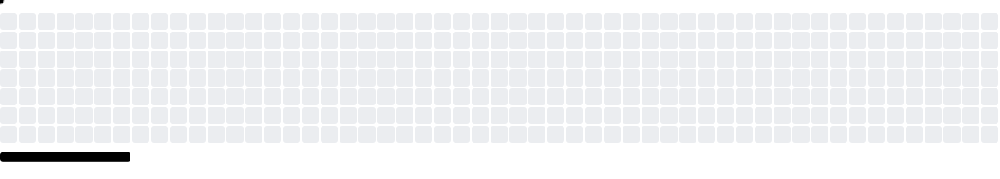

 <!--  -->

  <h3>
    Hi, I'm Eric
    
  </h3>
  
<em>Simplify everything.</em> ✨

<table align="center">
  <tr>
    <td width="60%" align="center" valign="top">
      <h3>📊 GitHub Stats</h3>
      <a href="https://github.com/Ericismee">
        <picture>
          <source media="(prefers-color-scheme: dark)" srcset="https://github-profile-summary-cards.vercel.app/api/cards/stats?username=Ericismee&amp;theme=github_dark&amp;hide_logo=true&amp;bg_color=151321&amp;border_color=332849&amp;title_color=6EE7B7&amp;text_color=E6EDF3&amp;icon_color=A855F7&amp;animation=rgb-soft">
          
        </picture>
      </a>
       
      <a href="https://github.com/Ericismee#contributions">
        <picture>
          <source media="(prefers-color-scheme: dark)" srcset="https://streak-stats.demolab.com/?user=Ericismee&amp;hide_border=true&amp;background=00000000&amp;ring=A855F7&amp;fire=6EE7B7&amp;currStreakLabel=6EE7B7&amp;sideLabels=8B949E&amp;currStreakNum=A855F7&amp;sideNums=A855F7&amp;dates=8B949E&amp;stroke=30363D&amp;timezone=Asia%2FHo_Chi_Minh">
          
        </picture>
      </a>
    </td>
    <td width="40%" align="center" valign="top">
      <h3>🧠 My Knowledge</h3>
      
       
      <a href="https://github.com/Ericismee?tab=repositories">
        <picture>
          <source media="(prefers-color-scheme: dark)" srcset="https://github-stats-extended.vercel.app/api/top-langs?username=Ericismee&amp;layout=compact&amp;langs_count=5&amp;card_width=255&amp;theme=dark_github&amp;hide_border=true&amp;bg_color=00000000&amp;title_color=6EE7B7&amp;text_color=C9D1D9">
          
        </picture>
      </a>
    </td>
  </tr>
</table>

  <strong>🎮 Contribution Breakout</strong> 
  <picture>
    <source media="(prefers-color-scheme: dark)" srcset="https://raw.githubusercontent.com/Ericismee/Ericismee/output-pacman/breakout-contribution-graph-dark.svg">
    
  </picture>

